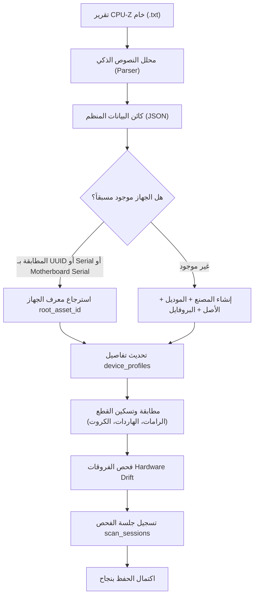

# وثيقة مواصفات وتحليل تقارير CPU-Z (CPU-Z Parser Specification)
## مشروع عَتاد (Ataad) - متوافق مع المخطط v3.0
**المكون:** محلل النصوص الذكي لتقارير CPU-Z وخوارزمية التسكين في قاعدة البيانات  
**الهدف:** تحويل ملف التقرير النصي الخام (`.txt`) الناتج عن أداة `cpuz.exe` إلى كائنات منظمة ومطابقتها وتسكينها في طبقتي الكتالوج والمخزون (`manufacturers`, `asset_models`, `assets`, `device_profiles`).

---

## 1. بنية ملف تقرير CPU-Z النصي (Report Structure)

يتميز تقرير CPU-Z بكونه ملفاً نصياً منظماً مقسماً إلى أقسام رئيسية تفصل بينها عناوين وخطوط فاصلة (`--------------------`)، وتفصل بين المفاتيح وقيمها مسافات جدولة (`\t`) أو مسافات فارغة:

```text
CPU-Z TXT Report
-------------------------------------------------------------------------

Binaries
-------------------------------------------------------------------------
CPU-Z version			2.01.0.x64

Processors
-------------------------------------------------------------------------
Number of sockets		1
Number of threads		4

APIC ID				0
	Device			Processor
	Name			Intel Core i7 4600M
	Code Name		Haswell
	Specification		Intel(R) Core(TM) i7-4600M CPU @ 2.90GHz
	Package (platform ID)	Socket 947 rPGA (0x4)
    ...
```

---

## 2. خريطة استخراج الحقول (Field Mapping Matrix)

يوضح الجدول التالي كل معلومة يستخرجها المحلل، وقسم التقرير في CPU-Z، وقاعدة التنظيف والمعالجة:

### 2.1 معلومات الجهاز الأساسية واللوحة (Host & Motherboard Information)

| الحقل المستخرج | قسم التقرير في CPU-Z | المفتاح في الملف النصي | قاعدة التنظيف والمعالجة |
| :--- | :--- | :--- | :--- |
| `manufacturer` | `DMI System Info` | `manufacturer` | إزالة الفراغات الطرفية، تجاهل "To be filled by O.E.M." |
| `model` | `DMI System Info` | `product` | اسم الموديل التجاري (مثل `Latitude E6440`) |
| `system_serial` | `DMI System Info` | `serial` | إذا كان القيمة الافتراضية "Default string" تُعامل كـ `NULL` |
| `system_uuid` | `DMI System Info` | `UUID` | تنظيف الأقواس المعقوفة `{}` وتوحيد الأحرف الصغيرة |
| `chassis_subtype` | `DMI System Enclosure`| `chassis type` | تحويلها إلى: `laptop`, `desktop_tower`, `sff`, `mini_pc`, `server_rack` |
| `motherboard_vendor` | `DMI Baseboard` | `vendor` | اسم مصنع اللوحة الأم |
| `motherboard_model` | `DMI Baseboard` | `model` | موديل اللوحة الأم الدقيق |
| `motherboard_serial` | `DMI Baseboard` | `serial` | سيريال اللوحة (بديل حاسم في الأجهزة المجمعة) |
| `chipset` | `Chipset` | `Northbridge` / `Southbridge` | استخراج اسم شريحة اللوحة (مثل `Intel Haswell-ULT`) |
| `bios_version` | `DMI BIOS` | `version` | إصدار البيوس الحالي |
| `bios_date` | `DMI BIOS` | `date` | تاريخ إصدار البيوس (مثل `05/19/2017`) |
| `max_ram_capacity_mb` | `DMI Physical Memory Array` | `Max Capacity` | استخراج رقم الحد الأقصى للرام بالـ MB (مثل `16384`) |
| `ram_slots_count` | `DMI Physical Memory Array` | `Number of Devices` | عدد منافذ الرام في اللوحة (مثل `2` أو `4`) |

### 2.2 مواصفات المعالج التفصيلية (Processor Detailed Specifications)

| الحقل المستهدف | القسم | المفتاح | التفاصيل المستخرجة |
| :--- | :--- | :--- | :--- |
| `cpu_model` | `Processors` (APIC ID 0) | `Name` | اسم المعالج (مثل `Intel Core i7 4600M`) |
| `cpu_code_name` | `Processors` | `Code Name` | المعمارية (مثل `Haswell`, `Zen 3`) |
| `cpu_socket` | `Processors` | `Package (platform ID)` | نوع المقبس (مثل `Socket 947 rPGA`) |
| `cpu_cores` | `Processors` | يُستنتج من APIC IDs | عدد الأنوية الفيزيائية للمعالج |
| `cpu_threads` | `Processors` | `Number of threads` | عدد المسارات الكلية للمعالج |
| `cpu_base_clock_mhz` | `Processors` | `Specification` / `Core 0` | استخراج التردد الأساسي بالـ MHz (مثل `2900`) |
| `cpu_boost_clock_mhz` | `Processors` / `DMI Processor` | `Max Speed` | استخراج أقصى سرعة بالـ MHz (مثل `3600`) |
| `cpu_l3_cache_kb` | `Processors` | `L3 Cache` | حجم كاش المستوى الثالث بالـ KB (مثل `4096`) |
| `cpu_tdp_watts` | `Processors` | `TDP` / استنتاج من الموديل | استهلاك الطاقة التصميمي بالواط |
| `cpu_has_virtualization` | `Processors` | `Instructions` | فحص وجود `VT-x` أو `AMD-V` (1 أو 0) |
| `cpu_summary` | `Processors` | `Specification` | النص الكامل مع التردد من CPU-Z للعرض |

### 2.3 نظام التشغيل والشبكة (OS & System Environment)

| الحقل المستهدف | القسم | المفتاح | التفاصيل المستخرجة |
| :--- | :--- | :--- | :--- |
| `os_name` | `Software` | `Windows Version` | نظام التشغيل (مثل `Microsoft Windows 10 Professional 64-bit`) |
| `os_build` | `Software` | `Build` | رقم بناء النظام (مثل `19045`) |

### 2.4 شرائح الرام (Memory SPD)
يُستخرج من قسم **`Memory SPD`** حيث يتكرر كتلة لكل منفذ رام تحت اسم `DIMM # 1`, `DIMM # 2`, إلخ:

| الحقل | المفتاح في التقرير | مثال القيمة في الملف | قاعدة التنظيف |
| :--- | :--- | :--- | :--- |
| `slot_or_bus` | عنوان الكتلة | `DIMM # 1` | يُحفظ كرقم المنفذ |
| `manufacturer` | `Manufacturer (ID)` | `Samsung (CE00000000000000000000)` | إزالة معرف الـ Hex بين القوسين والإبقاء على `Samsung` |
| `capacity_mb` | `Size` | `4096 MBytes` | استخراج الرقم فقط: `4096` |
| `memory_type` | `Memory type` | `DDR3` أو `DDR4` أو `DDR5` | نص موحد |
| `module_format` | `Module format` | `SO-DIMM` (لابتوب) أو `UDIMM` (مكتبي) | تصنيف الحجم الفيزيائي للشريحة |
| `serial_number`| `Serial number` | `1770EBC2` | **السيريال الفعلي المطبوع على الشريحة** |
| `part_number` | `Part number` | `M471B5173DB0-YK0` | رقم الموديل المصنعي الدقيق |
| `speed_mhz` | `Max bandwidth` | `PC3-12800 (800 MHz)` | استخراج التردد الفعال (1600 MHz) |
| `voltage` | `Nominal Voltage` | `1.35 Volts` | تحويله لرقم عشري (`1.35` لـ DDR3L مقابل `1.5` لـ DDR3) |
| `mfg_date` | `Manufacturing date`| `Week 34/Year 14` | أسبوع وسنة التصنيع |

> [!NOTE]
> **خطة الطوارئ البديلة (Fallback Plan):**  
> في الأجهزة الافتراضية (VMs) أو بعض الأجهزة التي لا يتيح نظامها الوصول إلى SMBus، قد يكون قسم `Memory SPD` غير متاح؛ يتراجع المحلل تلقائياً لقراءة قسم `DMI Memory Device` لاستخراج سعة ونوع الرامات الإجمالية.

### 2.5 وسائط التخزين (Storage Drives)
يُستخرج من قسم **`Storage`** لكل قرص (`Drive 0`, `Drive 1`):

| الحقل | المفتاح | مثال | التحويل |
| :--- | :--- | :--- | :--- |
| `model_name` | `Name` | `SUPERSONIC256` | موديل القرص |
| `serial_number` | `Serial Number` | `VT256SS034636 VC08` | سيريال القرص الفريد |
| `capacity_gb` | `Capacity` | `238.5 GB` | استخراج الرقم العشري `238.5` |
| `media_type` | `Type` | `Fixed, SSD` | استنتاج هل هو `SSD` أم `HDD` |
| `bus_interface`| `Bus Type` | `SATA (11)` أو `NVMe` | نوع الاتصال |
| `firmware_rev` | `Revision` | `T1130A0` | إصدار الفيرموير |

### 2.6 كروت الشاشة (Display Adapters)
يُستخرج من قسم **`Display Adapters`** لكل كرت (`Display adapter 0`, `Display adapter 1`):

| الحقل | المفتاح | مثال |
| :--- | :--- | :--- |
| `name` | `Name` | `Intel(R) HD Graphics 4600` / `AMD Radeon HD 8600M` |
| `manufacturer` | `Board Manufacturer` | `Dell` |
| `vendor_id` | `Vendor ID` | `0x8086` (Intel) أو `0x1002` (AMD) |
| `model_id` | `Model ID` | `0x0416` |

---

## 3. عقد المخرجات المنظم (Parsed Output Data Contract)

بعد انتهاء المحلل من قراءة الملف، يُصدر كائناً برمجياً موحداً (JSON):

```json
{
  "parser_version": "2.1",
  "source_file": "MINWINPC.txt",
  "device": {
    "manufacturer": "Dell Inc.",
    "model": "Latitude E6440",
    "system_serial": "5N0GN12",
    "system_uuid": "4c4c4544-004e-3010-8047-b5c04f4e3132",
    "chassis_subtype": "laptop",
    "motherboard_vendor": "Dell Inc.",
    "motherboard_model": "0K9GNV",
    "motherboard_serial": "/5N0GN12/CN129634B40029/",
    "chipset": "Intel Haswell-ULT",
    "bios_version": "A18",
    "bios_date": "05/19/2017",
    "max_ram_capacity_mb": 16384,
    "ram_slots_count": 2,
    "cpu_model": "Intel Core i7 4600M",
    "cpu_code_name": "Haswell",
    "cpu_socket": "Socket 947 rPGA",
    "cpu_cores": 2,
    "cpu_threads": 4,
    "cpu_base_clock_mhz": 2900,
    "cpu_boost_clock_mhz": 3600,
    "cpu_l3_cache_kb": 4096,
    "cpu_tdp_watts": 37,
    "cpu_has_virtualization": 1,
    "cpu_summary": "Intel(R) Core(TM) i7-4600M CPU @ 2.90GHz (2C/4T)",
    "os_name": "Microsoft Windows 10 Professional 64-bit",
    "os_build": "19045",
    "total_ram_mb": 8192,
    "total_storage_gb": 238.5
  },
  "ram_modules": [
    {
      "slot": "DIMM # 1",
      "manufacturer": "Samsung",
      "model_name": "M471B5173DB0-YK0",
      "part_number": "M471B5173DB0-YK0",
      "serial_number": "1770EBC2",
      "capacity_mb": 4096,
      "memory_type": "DDR3",
      "module_format": "SO-DIMM",
      "speed_mhz": 1600,
      "voltage": 1.35,
      "mfg_date": "Week 34/Year 14"
    },
    {
      "slot": "DIMM # 2",
      "manufacturer": "Samsung",
      "model_name": "M471B5173DB0-YK0",
      "part_number": "M471B5173DB0-YK0",
      "serial_number": "1770EC34",
      "capacity_mb": 4096,
      "memory_type": "DDR3",
      "module_format": "SO-DIMM",
      "speed_mhz": 1600,
      "voltage": 1.35,
      "mfg_date": "Week 34/Year 14"
    }
  ],
  "storage_drives": [
    {
      "slot_or_bus": "SATA (11)",
      "model_name": "SUPERSONIC256",
      "serial_number": "VT256SS034636 VC08",
      "capacity_gb": 238.5,
      "media_type": "SSD",
      "firmware": "T1130A0"
    }
  ],
  "gpus": [
    {
      "name": "Intel(R) HD Graphics 4600",
      "manufacturer": "Dell",
      "type": "Integrated",
      "vendor_id": "0x8086",
      "model_id": "0x0416"
    },
    {
      "name": "AMD Radeon HD 8600M Series",
      "manufacturer": "Dell",
      "type": "Dedicated",
      "vendor_id": "0x1002",
      "model_id": "0x6660"
    }
  ]
}
```

---

## 4. خوارزمية التسكين في قاعدة البيانات v3.0 (Database Ingestion Pipeline)

تتبع عملية إدخال التقرير في المخطط v3.0 الخطوات المنهجية التالية:



### الخطوة 1: تسكين المصنع والموديل للجهاز الرئيسي
1. فحص جدول `manufacturers`: البحث عن `Dell Inc.`، وإن لم يوجد يتم إدراجه.
2. فحص جدول `asset_models`: البحث عن موديل `Latitude E6440` المرتبط بنوع `DEVICE` والمصنع، وإدراجه إن لم يوجد.

### الخطوة 2: مطابقة الأصل الحاضن (Root Asset)
1. البحث في `device_profiles` بمطابقة الأولويات:
   * `system_uuid` (الأدق في الأجهزة العالمية).
   * `system_serial` (إن لم يكن Default string).
   * `motherboard_serial` (حاسم في الأجهزة المجمعة).
2. إذا وُجد: يتم تحديث `last_scanned_at` و `device_profiles`.
3. إذا لم يوجد: يتم إنشاء صف جديد في `assets` (مع `status = 'active'`) وإنشاء صف `device_profiles` المرتبط به.

### الخطوة 3: تسكين القطع الفرعية (Children Components)
لكل قطعة (شريحة رام، هارد، كرت شاشة):
1. **الكتالوج:** التحقق من وجود المصنع والموديل في `manufacturers` و `asset_models`.
2. **المخزون:** البحث عن القطعة في `assets`:
   * المطابقة أولاً بـ `serial_number` الفريد.
   * إن لم يتوفر سيريال (مثل بعض الهاردات العادية): المطابقة بـ `parent_asset_id` + `slot_or_bus`.
3. **التحديث أو الإدراج:**
   * إذا وُجدت القطعة وكانت في الدرج (`in_storage`)، يتم تحديث `parent_asset_id = root_asset_id` و `status = 'installed'` وتسجيل حركة `installed` في `custody_logs`.
   * إذا لم تكن موجودة مطلقاً في النظام، تُدرج كأصل جديد مركب.

### الخطوة 4: محرك كشف التغييرات (Hardware Drift Engine)
يقارن النظام بين القطع التي كانت مركبة في الجهاز قبل الفحص، والقطع الموجودة في التقرير الجديد:
* **قطعة جديدة رُصدت:** تسجيل حدث `PART_ADDED`.
* **قطعة كانت موجودة واختفت:** تسجيل حدث `PART_REMOVED` في `hardware_drift_logs`.
* **قطعة تم تبديلها بسيريال آخر في نفس المنفذ:** تسجيل حدث `PART_SWAPPED`.

---

## 5. الحالات الاستثنائية وكيفية معالجتها (Edge Cases & Resilience)

1. **الترميز (File Encodings):** محاولة القراءة تلقائياً بالترتيب: `utf-8` ثم `cp1252` ثم `latin-1`.
2. **قيم OEM الافتراضية:** تحويل القيم غير المجدية مثل `To be filled by O.E.M.` أو `None` أو `Default string` إلى `NULL`.
3. **تعدد كروت الشاشة:** دعم رصد كرتين في آن واحد (كرت مدمج لتوفير الطاقة وكرت ألعاب منفصل).
4. **أجهزة الـ Virtual Machines:** الاستعانة بـ Fallback من قسم `DMI Memory Device` عند غياب `Memory SPD`.
